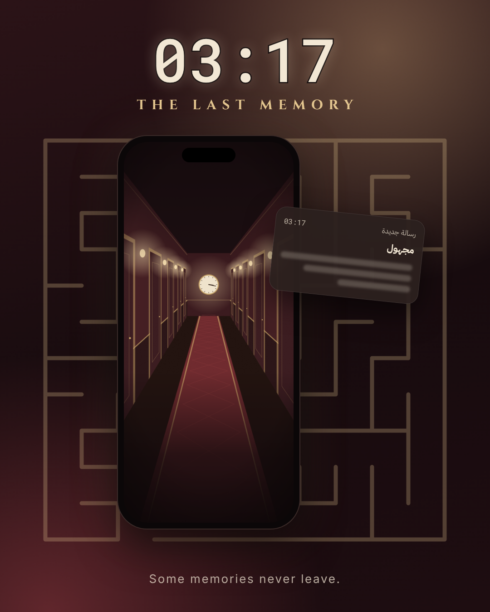

# 03:17 · The Last Memory

لعبة غموض ثلاثية الأبعاد تعمل على المتصفح. تمشي في ممرات فندق قديم بمنظور الشخص الأول، وتدوّر على باب الخروج قبل ما يخلص الوقت.



> Some memories never leave.

## القصة

وصلتك رسالة من رقم ما تعرفه: صورة لفندق قديم، وجملة وحدة: «أنا لسه هنا.»
رحت تشوف وش السالفة... والفندق ما خلّاك تطلع.

خمس مراحل، كل وحدة تكشف جزء جديد من القصة.

## التشغيل

تحتاج **Node.js** بإصدار 20.19 أو أحدث.

```bash
npm install
npm run dev
```

افتح الرابط اللي يطلع في الطرفية، واضغط **ابدأ القصة**.

| الأمر | وش يسوي |
| --- | --- |
| `npm run dev` | يشغّل اللعبة على جهازك |
| `npm run build` | يجهّز نسخة النشر في مجلد `dist` |
| `npm run deploy` | يبني وينشر على Cloudflare Pages |

## طريقة اللعب

| الزر | الوظيفة |
| --- | --- |
| `W A S D` أو الأسهم | المشي |
| الفأرة | النظر |
| `Shift` | الجري |
| `F` | الكشاف |
| `Space` | تخطّي الجملة |
| `Esc` أو `P` | إيقاف مؤقت |
| `M` | كتم الصوت |

على الجوال: اسحب يسار الشاشة للمشي، ويمينها للنظر.

في كل مرحلة غرض واحد لازم تلقاه قبل ما ينفتح باب المخرج. اللوحات والأغراض الثانية اختيارية، قرّب منها وطالع فيها.

## هيكل المشروع

| المسار | المحتوى |
| --- | --- |
| `src/maze/` | محرك اللعبة: المتاهة، الحركة، الإضاءة، الصوت، الواجهة |
| `src/maze/story/` | القصة: المراحل، الرسومات، ظهور ليان، الأحداث |
| `src/assets/fonts/` | الخطوط مع رخصها |
| `art/posters/` | البوسترات (ملفات قابلة للتعديل + صور جاهزة في `exports/`) |
| `index.html` و `src/style.css` | الشاشات والتصميم |

## التعديل

- **النصوص والمراحل:** كلها في `src/maze/story/stages.js`.
- **الألوان والسرعات والصعوبة:** في `src/maze/config.js`.
- **صور حقيقية بدل الرسومات:** أضفها في `ART_OVERRIDES` داخل `src/maze/story/art.js`.
- **تسجيلات صوتية للحوارات:** أضفها في `VOICE_FILES` داخل `src/maze/audio.js`.

## مبنية بـ

[Vite](https://vite.dev) و [Three.js](https://threejs.org)، بدون صور أو أصوات خارجية: كل الرسومات والأصوات مولّدة بالكود.

الخطوط: IBM Plex Sans Arabic و Inter و Cinzel و Roboto Mono، وكلها برخصة SIL Open Font License.

---

دليل ورشة العمل الأصلي موجود في [WORKSHOP.md](WORKSHOP.md).
